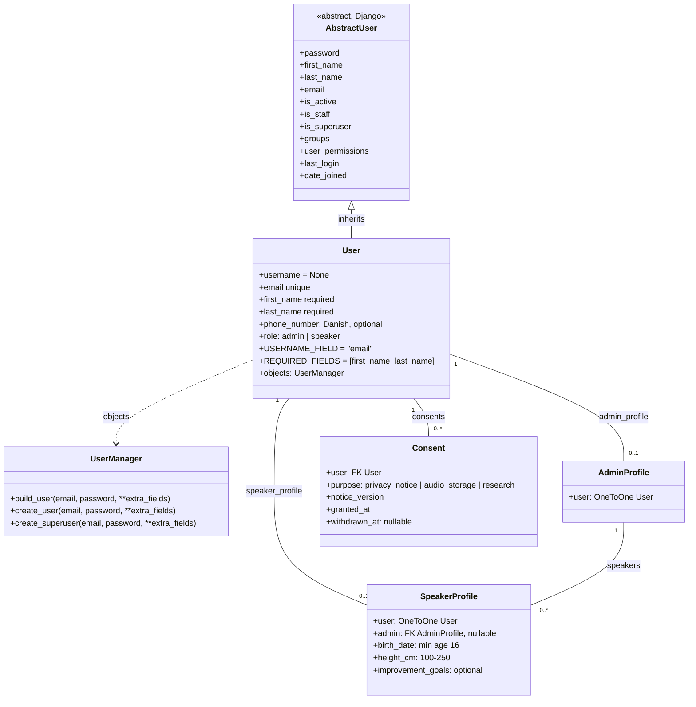

# User Models

https://docs.djangoproject.com/en/dev/topics/auth/customizing/#extending-django-s-default-user 

## User & User Manager
To remove the username for our application we need to define a new user manager as the default one only supports registering with username. The rest is kept becuase they are relevant to our application

## Concent
In order to be GDPR compliant we need to ensure that the user has a chance to accept or withdraw concents and for that we need a table storing this to avoid polluting the user model

### Profiles
To keep our app simple and isolate the login and basic user functionality we are using profiles for both admin and speaker this allows the application to handle users the same way but allows for the role based customization

"When you start your project with a custom user model, stop to consider if this is the right choice for your project.
Keeping all user related information in one model removes the need for additional or more complex database queries to retrieve related models. On the other hand, it may be more suitable to store app-specific user information in a model that has a relation with your custom user model. That allows each app to specify its own user data requirements without potentially conflicting or breaking assumptions by other apps. It also means that you would keep your user model as simple as possible, focused on authentication, and following the minimum requirements Django expects custom user models to meet."

## Admin profile
Admin profile are the owners of the training facility they do not need birth dates etc therefore they have a differnet profile that relates the speakers to them

## Speaker Profile
To allow for good insides a set of data is required because the biomarkers are required for the voice measures