# Pivot: real-time architecture decisions

This document compares the options for four engineering decisions in Pivot's live session pipeline, so the team can choose one per decision and record the reasoning in the report.

1. **Audio:** how the speaker's voice gets from the browser to the backend
2. **Process layout:** whether the real-time part runs inside the Django web process or as its own process
3. **Background jobs:** Celery + Redis, or our own job queue in Postgres
4. **Stream audio storage:** where the real-time part keeps the audio it receives during a talk

Each decision has a diagram per option, a short explanation, a comparison table and a recommendation.

---

## Context: what the system does

- The **desktop browser** captures the speaker's microphone. The **mobile app** shows the live view.
- The **board** sends stability data to the backend: UDP for live packets, TCP batches for the complete record (SCRUM-152, SCRUM-153).
- The **backend** streams stability, the live transcript and the live voice score back to the screens over WebRTC data channels.
- **Live feedback** (transcript, voice score) runs during the talk. The **final analysis** (full voice module, final transcript, stability score) runs once after each talk and is stored.

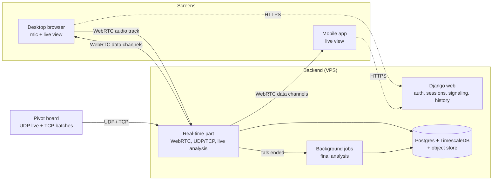

The diagram shows logical roles. Decision 2 settles whether "Django web" and "Real-time part" are one process or two; decision 3 settles how "Background jobs" is built.

**Applies to every option below:** live analysis runs where the audio already is (the real-time part, in a separate OS process it starts, so the event loop never freezes). The final analysis runs as a background job, because it can take minutes and must survive restarts and support retries (SCRUM-69).

---

## Decision 1: How audio gets to the backend

### Option 1A: Fixed chunks

The browser records fixed-length pieces (e.g. 10 s) and uploads each one over HTTPS. The backend transcribes and analyses each chunk on its own.

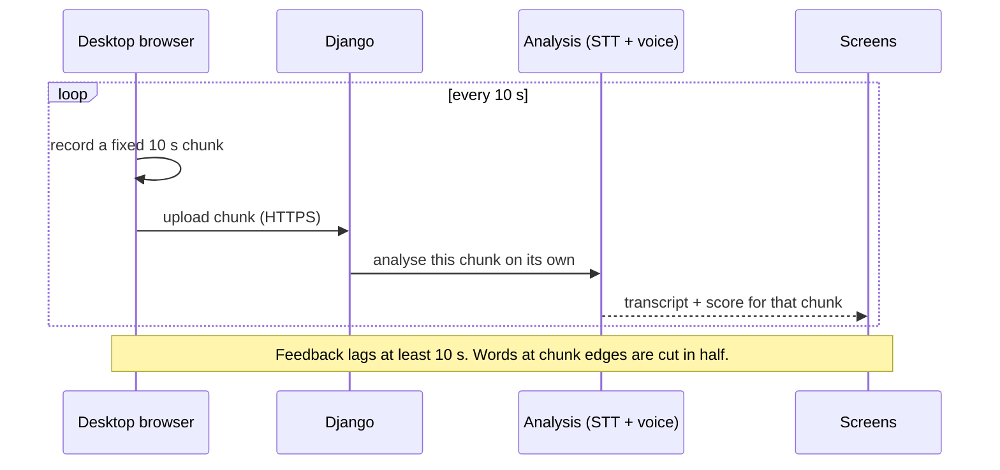

- Simple, reliable delivery: a failed upload is retried, nothing is lost or invented.
- But feedback is always at least one chunk behind, words and pauses at chunk edges are cut, and a 10 s window of pitch and rate is judged in isolation.
- Browser gotcha: `MediaRecorder` chunks (WebM) after the first have no file header and can't be decoded alone, so the client must build WAV chunks itself (AudioWorklet).

### Option 1B: Stream live, upload the exact recording in chunks during the talk

The browser streams audio continuously on the WebRTC audio track for everything live. In parallel it records a lossless copy and uploads it in pieces (e.g. every 30 s) over HTTPS. The final analysis runs on the joined exact recording.

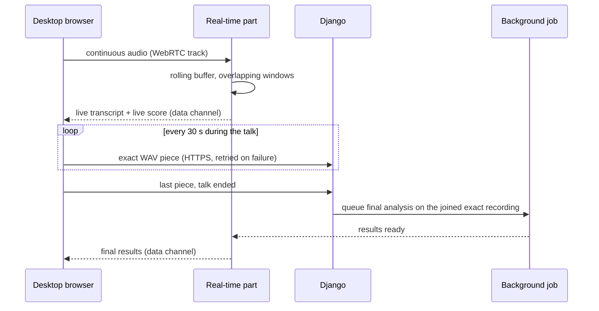

- Live feedback within about a second; cut words don't matter because the server analyses overlapping windows of one continuous buffer.
- The exact copy survives network drops: missed pieces are uploaded once the connection is back.
- Most work: streaming, recording, piece-wise upload with retries, and joining the pieces on the server.

### Option 1C: Stream live, upload the exact recording as a whole at the end

Same live path as 1B. The lossless copy is uploaded once, when the talk ends. Until it arrives (or if it never does), the audio saved from the stream (SCRUM-92) is used.

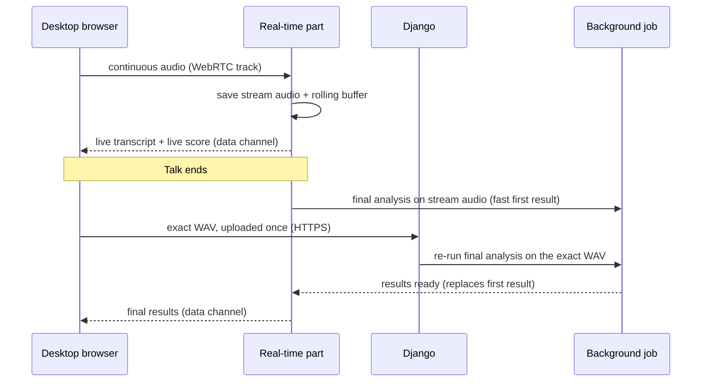

- Same live quality as 1B with much less client and server logic: one upload, no joining.
- If the browser closes before uploading, the talk still has results from the stream audio.
- **Minimum version:** skip the upload entirely ("stream only") and log packet loss per talk; add the upload when loss shows up or exact numbers become important.

### Comparison

| | 1A Fixed chunks | 1B Stream + chunked exact upload | 1C Stream + exact upload at the end |
| --- | --- | --- | --- |
| Live feedback delay | 10 s or more | About 1 s | About 1 s |
| Words cut at boundaries | Yes | No (overlapping windows) | No (overlapping windows) |
| Exact audio for the final analysis | Yes | Yes | Yes (stream audio as fallback) |
| Survives a network drop mid-talk | Yes | Yes | Exact copy yes (uploaded at the end); live feedback pauses |
| Client work | Recording, chunking, retry queue | Streaming + recording + chunked retry upload | Streaming + one recording, one upload |
| Backend work | Upload view, per-chunk analysis | Stream handling + piece joining | Stream handling + one upload view |
| Fits existing tickets (SCRUM-66, 92) | No (no WebRTC audio) | Yes, adds work | Yes, smallest addition |

**Recommendation: 1C.** Start with stream only, log packet loss, and add the end-of-talk WAV upload as an upgrade. Choose 1B only if long network drops during talks turn out to be common.

---

## Decision 2: Real-time part inside Django or as its own process

### Option 2A: Inside the Django web process

aiortc and the UDP/TCP listeners run inside Django's ASGI process, next to the normal views.

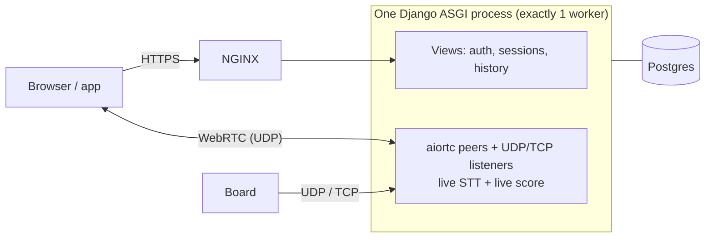

- One process to run; no internal calls between processes.
- Every deploy, restart or code reload drops all live sessions (including `runserver` auto-reload during development).
- Django must run with a single worker, because all connections of a talk have to share memory; web pages and live traffic compete for the same process.
- The web container itself must expose UDP/TCP ports, so it can't sit only behind NGINX.

### Option 2B: Separate real-time process from the same codebase

The same Django project is started twice: once as the web app, once as `manage.py run_realtime`. Django forwards WebRTC offers to the real-time process over an internal HTTP call.

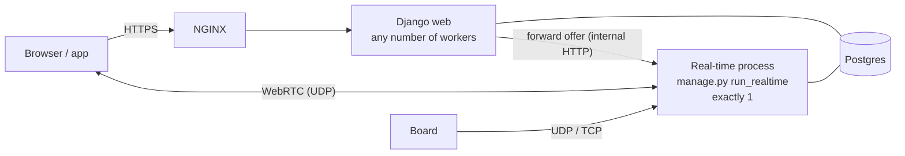

- Web can be redeployed and scaled freely; live sessions only drop when the real-time process restarts.
- Only the real-time container needs public UDP/TCP ports; web stays behind NGINX on 127.0.0.1.
- Same models, settings and image for both; Docker Compose starts the image with two different commands.
- Slightly more setup: one more container, one internal endpoint.

### Comparison

| | 2A Inside Django | 2B Separate process, same codebase |
| --- | --- | --- |
| Processes to run | 1 | 2 (same image) |
| Deploying web drops live sessions | Yes | No |
| Web can scale to several workers | No | Yes |
| Public UDP/TCP ports on | Web container | Real-time container only |
| Shared code and models | Yes | Yes |
| Extra code | None | Internal `/offer` endpoint, management command |
| Good for | Prototype, demo | Anything deployed and tested with real users |

**Recommendation: 2B.** Keep all WebRTC code in its own `rtc` app from day one, so even a 2A prototype can move to 2B by changing only how the code is started.

---

## Decision 3: Background jobs

Background jobs: final voice analysis, final transcript, stability score per talk, data export (SCRUM-114), anonymization (SCRUM-125). The worker runs one job at a time so heavy analysis never slows down live feedback.

### Option 3A: Celery + Redis

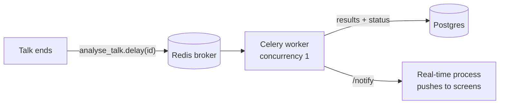

- Industry-standard tool with retries, time limits, scheduling (Celery Beat) and monitoring (Flower); valuable experience.
- Adds Redis as a service to deploy, secure and back up.
- Settings need care (`acks_late`, time limits) or jobs are lost when a worker dies.
- No official Windows support for workers: run them in Docker or WSL during development.
- Jobs must be queued after the database commit (`transaction.on_commit`).

### Option 3B: Own job queue in Postgres

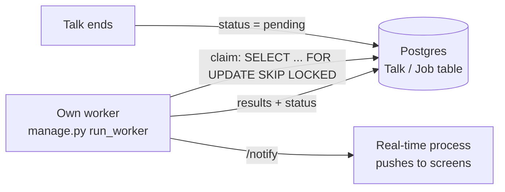

- No new service; jobs are rows next to the data, saved in the same transaction as the talk.
- Easy to inspect (SQL, Django admin) and durable by default.
- We write retries, crash recovery (reset jobs stuck in "running") and the worker loop ourselves, roughly 50 to 100 lines plus tests.
- Shows understanding of how queues work: row locking, at-least-once delivery, jobs that are safe to run twice.

Middle ground: **Procrastinate**, a library that keeps jobs in Postgres and provides retries and scheduling, without Redis.

### Comparison

| | 3A Celery + Redis | 3B Own Postgres queue |
| --- | --- | --- |
| New services | Redis | None |
| Retries, time limits | Built in | Own code |
| Scheduled jobs | Celery Beat (extra process) | Cron or worker loop |
| Jobs and data in one transaction | No (`on_commit` needed) | Yes |
| Durability on crash | Depends on Redis persistence settings | Yes |
| Learning effort | 2 to 4 days to a sound setup | 1 to 3 days including edge cases |
| Throughput | Far beyond our needs | Far beyond our needs |
| Report value | Adopting a standard tool | Understanding queue mechanics |

**Recommendation: 3B** (or Procrastinate) for our scale and setup. Choose 3A if learning Celery is a team goal, and state that reason in the report.

---

## Decision 4: Storing the stream audio on the server

With 1C, the real-time process receives the trainer's voice as a stream of small audio frames (about 20 ms each). The audio is used twice:

1. **Live windows:** a 30 s window every 5 s, analysed with `VoiceAnalysis.get_short_analysis` and saved as a `PartialVoiceResult`. This only needs the most recent 30 s. `VoiceAnalysis` takes a file path, so each window is written to a temporary WAV.
2. **The full talk:** analysed once after `finish_talk` with `get_long_analysis`. This needs the whole recording, kept safe until it is in the object store (MinIO) as `Talk.audio`.

Terms used below:

- **PCM:** raw audio samples, one number per measurement, with no header. At 16 kHz, 16-bit, mono that is 32 KB/s, about 2 MB per minute. A PCM file can be appended to at any time, and whatever was written before a crash is still valid audio.
- **WAV:** PCM with a 44-byte header that states the format and the data length. Python's `wave` module only writes the length on `close()`, so a WAV that is being written during the talk is broken if the process crashes.
- **Ring buffer:** a fixed-size buffer that drops the oldest data when new data arrives, so it always holds exactly the last 30 s (`collections.deque(maxlen=...)`).

### Option 4A: Memory only

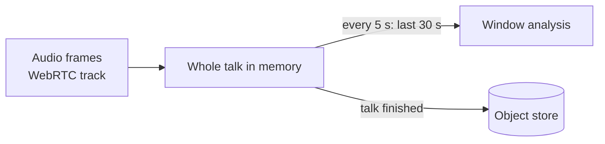

- Simplest: no files on the server.
- A crash, deploy or restart of the real-time process loses the whole recording of every running talk.
- Memory grows with talk length (about 115 MB per hour of talk).

### Option 4B: Raw PCM on local disk + ring buffer in memory

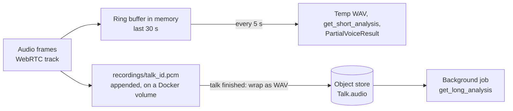

- A crash loses at most the last flush (about 1 s), and the file is recovered on startup.
- Memory stays at about 1 MB per talk, however long the talk is.
- Reconnects are simple: the recording belongs to the talk, not to the connection, so audio after a reconnect is appended to the same file.
- Lost if the server's disk itself fails during the talk.

### Option 4C: Upload chunks to the object store during the talk

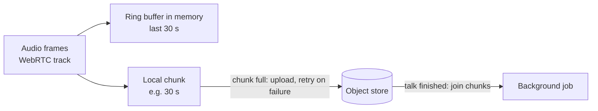

- Survives the whole server dying mid-talk.
- Most work: retries, ordering, joining the chunks and cleaning up orphaned chunks.
- Doesn't help the live windows: with a 5 s step every piece of audio is in 6 overlapping windows, so the windows still come from memory.
- A multipart upload straight to the object store isn't live either: every part except the last must be at least 5 MB (about 2.5 min of 16 kHz PCM).

Storing audio as database blobs was not considered: it bloats Postgres, and the object store exists for this.

### Comparison

| | 4A Memory only | 4B PCM on disk + ring buffer | 4C Chunks to object store |
| --- | --- | --- | --- |
| Real-time process crashes or restarts | Recording lost | At most ~1 s lost, recovered on startup | At most one chunk lost |
| Server disk fails mid-talk | Recording lost | Recording lost | Kept up to the last uploaded chunk |
| Memory per talk | Grows (~115 MB per hour) | ~1 MB | ~1 MB |
| Live windows come from | Memory | Ring buffer | Ring buffer |
| Extra code | None | Append + flush, WAV wrap, startup recovery | 4B plus upload, retries, joining, cleanup |

**Recommendation: 4B.** It covers the realistic failure (the real-time process restarting) with little code. Add 4C next to it only if whole-server failures during talks turn out to matter; the live side stays the same.

### Details for 4B

**Format**

- Resample every frame to one fixed format before writing: 16 kHz, mono, 16-bit, unless the analysis needs another rate (see open questions). After a reconnect the browser may send a different rate (with aiortc: `av.AudioResampler`).
- Record raw PCM and turn it into WAV only once, when the talk is finished. FLAC (lossless, about half the size) is an option for what is kept in the object store.
- Turn off the browser's audio processing in `getUserMedia` (`echoCancellation`, `noiseSuppression` and `autoGainControl` all `false`). Otherwise loudness and spectrum are changed before the server sees them, which skews `spl_dbfs`, pitch and spectral tilt.
- WebRTC carries Opus, which is lossy. Whether that is good enough for formants and spectral tilt is an open question; the exact WAV upload from 1C is the fix if not.

**Recording**

- One file per talk, `recordings/<talk_id>.pcm`, opened in append mode, on a Docker volume so a container restart doesn't wipe it.
- `flush()` and `os.fsync()` every 1 to 2 s.
- On finish: write a WAV header in front, upload with `FilesService`, set `Talk.audio`, delete the local file and queue the final analysis.
- On startup of the real-time process: `.pcm` files left from talks that are still RECORDING or PAUSED are wrapped as WAV, uploaded and set as `Talk.audio`. The audio is not lost, and a talk that ends up FAILED can be retried (`FAILED --> PROCESSING : retry [audio exists]` in LogicGraphs.md).

**Live windows (30 s every 5 s)**

- Every 5 s: ring buffer to temp WAV, `get_short_analysis`, save the `PartialVoiceResult`, delete the temp WAV.
- `start_at` is the receive time (UTC) of the window's first frame, so windows line up with the stability data directly.
- The analysis must take less than 5 s. It runs outside the event loop (`asyncio.to_thread` around `VoiceAnalysis`, which already runs the tool as a subprocess). If the previous window is still running, the next one is skipped rather than queued, so the feedback never falls behind. The analysis time is logged.
- The ring buffer is cleared on pause, so no window mixes audio from before and after a gap.

**Pauses and connection drops**

- During a drop no frames arrive, so nothing is written: the file has no gaps, and the pause intervals (`TalkPause`) map audio time back to real time.
- `paused_at` is the receive time of the last frame before the drop, not the moment the drop was detected (ICE takes a few seconds to notice). Otherwise every window after the drop is shifted by that delay.
- `resumed_at` is the receive time of the first frame after the reconnect.
- Short packet loss inside one connection doesn't pause the talk. It is logged per talk (1C); filling such gaps with silence based on the RTP timestamps is a later upgrade.

**When the exact WAV upload from 1C is added**

- The server PCM becomes the fallback if the browser upload never arrives.
- The browser's recorder must pause and resume on the same events as the talk. Otherwise its file contains audio from stretches that count as paused and no longer matches the pause intervals.

---

## Summary

| Decision | Options | Recommended | Main reason |
| --- | --- | --- | --- |
| 1. Audio | 1A fixed chunks / 1B stream + chunked exact upload / 1C stream + exact upload at the end | 1C, starting stream-only | Live feedback in about a second, exact audio available, least extra work |
| 2. Process layout | 2A inside Django / 2B separate real-time process | 2B | Deploys don't drop live sessions; only one container needs public ports |
| 3. Background jobs | 3A Celery + Redis / 3B own Postgres queue | 3B or Procrastinate | No extra service; jobs and data commit together |
| 4. Stream audio storage | 4A memory only / 4B PCM on disk + ring buffer / 4C chunks to object store during the talk | 4B | Survives a real-time process restart, about 1 MB memory per talk, little code |

### Decision matrix template

Scores 1 (poor) to 5 (good). The weights and scores below are a suggested starting point for discussion, not measurements.

| Criterion | Weight | 1A | 1B | 1C | 2A | 2B | 3A | 3B |
| --- | --- | --- | --- | --- | --- | --- | --- | --- |
| Meets live latency needs | 0.30 | 1 | 5 | 5 | 5 | 5 | n/a | n/a |
| Reliability / no data loss | 0.25 | 5 | 5 | 4 | 2 | 4 | 4 | 4 |
| Implementation effort (5 = least) | 0.20 | 3 | 2 | 4 | 5 | 4 | 3 | 3 |
| Operational simplicity | 0.15 | 4 | 3 | 4 | 4 | 4 | 2 | 5 |
| Learning / report value | 0.10 | 2 | 4 | 4 | 2 | 4 | 4 | 4 |

---

## Open questions

- Latency target: SCRUM-152 says under 250 ms board to screen; SCRUM-198 says under 50 ms sensor to screen. Which one is the requirement?
- Which sample rate does the voice-analysis module expect (16, 44.1 or 48 kHz)?
- How many talks can run at the same time on the VPS (SCRUM-140 load test)?
- Live windows at the start of a talk and after a resume: wait for a full 30 s window, or send shorter windows first (`window_length` is stored per row)? To agree with Oliver.
- Is the Opus-compressed stream audio good enough for formants and spectral tilt (`h1_h2_corrected`, `h1_a3_corrected`), or is the exact WAV upload from 1C needed from the start? To ask Oliver.
