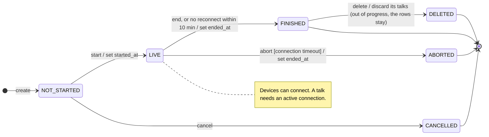
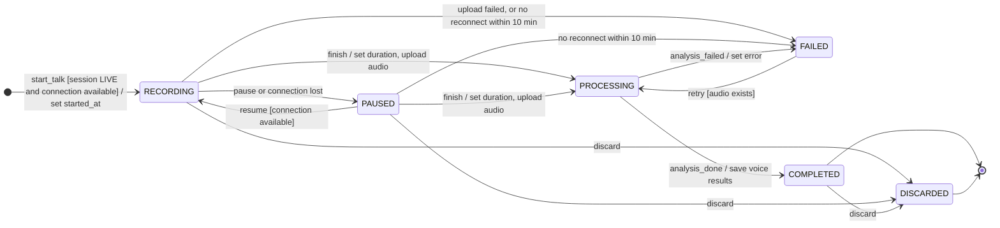
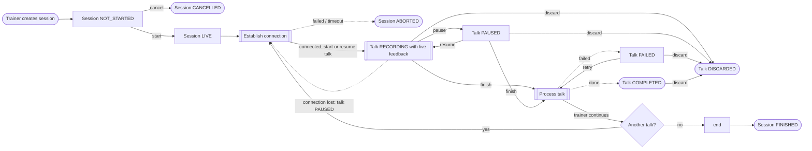
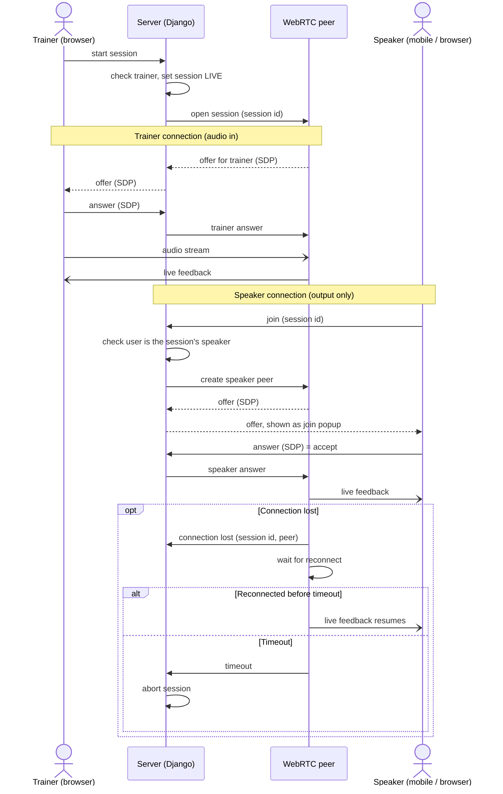
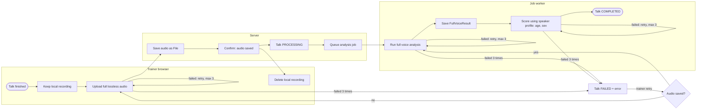

# State Machine
## Session

## Talk

## Flow

Session and talk state machines merged. Solid arrows are trainer actions, dotted arrows are the system (WebRTC layer, analysis worker). Double-bordered boxes are sub-flows, described in their own sections below.

Processing runs in the background, so the trainer can start the next talk without waiting for the analysis. If the connection drops during a talk, the talk is paused and the flow goes back to establishing the connection; once reconnected the talk resumes; if the trainer doesn't reconnect within 10 minutes the session is finished and the talk fails.

### Establish connection

Split in two: UDP for the board telemetry and WebRTC for the trainer and speaker devices. "Connected" means both are up.

#### UDP (board telemetry)

Separate diagram, to do.

#### WebRTC

UML sequence diagram. Solid arrows are requests, dashed arrows are replies, open arrowheads are asynchronous messages (streams). Django only does signaling over HTTP; media goes directly between the browsers and the WebRTC peer.

### Talk with live feedback

### Process talk

Runs after the whole talk is recorded. The live partial results are handled in Talk with live feedback, not here.

The browser keeps the recording until the server confirms it is saved, so a failed upload never loses audio. Each step retries automatically up to 3 times (with growing waits) before the talk is FAILED; after that the trainer can retry by hand, starting from the first unfinished step. How jobs are picked up (Django tasks, Celery, ...) is still open.
